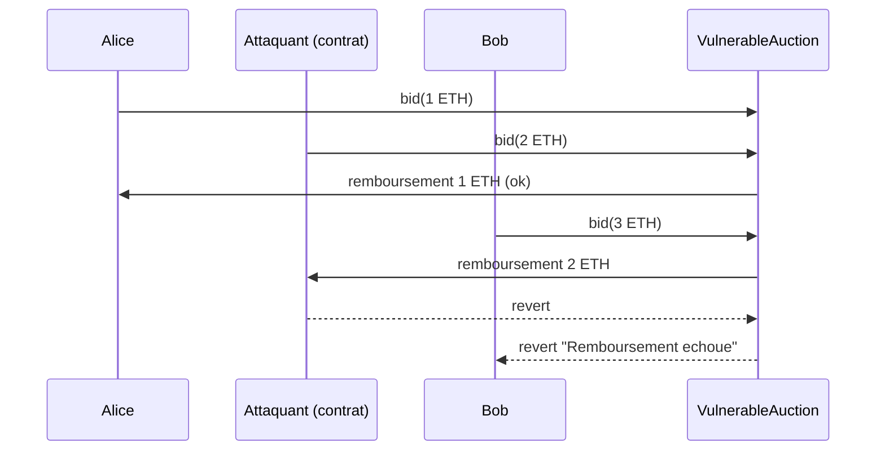

# Denial of Service (DoS)

## 1. Définition

Le **Denial of Service** (déni de service) survient quand un attaquant, ou simplement
une circonstance imprévue, empêche un smart contract de remplir sa fonction : une
fonction critique revert systématiquement, devient trop coûteuse pour tenir dans un
bloc, ou dépend d'un état que quelqu'un d'autre peut corrompre. Sur Ethereum, une
transaction qui échoue ne peut pas être « réessayée plus tard » si la cause est dans
l'état du contrat : le blocage est alors **permanent**, et les fonds qu'il détient
restent bloqués.

Ce document traite trois vecteurs, sur deux contrats :

| Vecteur | Mécanisme | Contrat |
|---|---|---|
| V1 : refus de remboursement | Un destinataire dont `receive()` revert bloque une fonction qui lui envoie de l'ETH | `VulnerableAuction` |
| V2 : destinataire bloquant dans une boucle | Un seul destinataire hostile fait échouer toute une distribution | `VulnerableAirdrop` |
| V3 : épuisement de gas | Une boucle non bornée dépasse la limite de gas du bloc | `VulnerableAirdrop` |

- Classification : SWC-113 (DoS with Failed Call), SWC-128 (DoS With Block Gas Limit),
  CWE-400 (Uncontrolled Resource Consumption), CWE-834 (Excessive Iteration)
- Sévérité : **Haute** (aucun vol de fonds, mais blocage permanent possible)

## 2. Contrats vulnérables

### 2.1 `VulnerableAuction` (V1)

Fichier : `src/vulnerable/VulnerableAuction.sol`

Une enchère : chaque offre doit dépasser la précédente, et l'ancien meilleur
enchérisseur est remboursé **immédiatement** dans la même transaction.

```solidity
if (previousBidder != address(0)) {
    (bool ok,) = previousBidder.call{value: previousBid}("");
    require(ok, "Remboursement echoue");
}
```

Le contrat suppose que le remboursement réussit toujours. Or si l'ancien enchérisseur
est un contrat dont `receive()` revert, `require(ok)` annule **toute** nouvelle
enchère. L'attaquant n'a qu'à miser une fois depuis un tel contrat pour devenir
meilleur enchérisseur à vie.



### 2.2 `VulnerableAirdrop` (V2 et V3)

Fichier : `src/vulnerable/VulnerableAirdrop.sol`

Un airdrop : les participants s'inscrivent, puis l'owner appelle `distribute()` qui
envoie à chacun sa part en une seule transaction.

```solidity
function register() external {
    participants.push(msg.sender);          // BUG 1 : ni plafond ni dédoublonnage
}

function distribute() external {
    // ...
    for (uint256 i = 0; i < n; i++) {        // BUG 2 : boucle non bornée
        (bool ok,) = participants[i].call{value: share}("");
        require(ok, "Envoi echoue");         // BUG 3 : un seul échec annule tout
    }
}
```

| Bug | Conséquence |
|---|---|
| Inscription illimitée et sans dédoublonnage | L'attaquant gonfle le tableau pour un coût minime |
| Boucle non bornée | Le coût de `distribute()` croît avec le nombre de participants jusqu'à dépasser la limite de gas |
| `require(ok)` dans la boucle | Un seul destinataire qui refuse l'ETH bloque tous les autres |

## 3. Exploitation

Fichier de test : `test/DenialOfService.t.sol` (contrats `RevertingBidder`,
`RevertingParticipant` et `DenialOfServiceExploitTest`)

| Test | Attaque | Impact |
|---|---|---|
| `test_Exploit_AuctionBlockedByRevertingBidder` | Un contrat qui revert dans `receive()` prend la tête de l'enchère | Bob ne peut plus surenchérir ; l'attaquant reste gagnant |
| `testFuzz_Exploit_NoOneCanOutbid` | Même scénario, montant d'offre aléatoire (256 combinaisons) | Aucune offre, même très élevée, ne passe |
| `test_Exploit_AirdropBlockedByRevertingParticipant` | Un contrat qui refuse l'ETH s'inscrit à l'airdrop | `distribute()` échoue à chaque essai ; 3 ETH bloqués |
| `test_Exploit_AirdropGasExhaustion` | 1 500 inscriptions depuis la même adresse | `distribute()` manque de gas (limite simulée : 10 M) ; 100 ETH bloqués |
| `test_Exploit_AirdropGasGrowsLinearly` | Mesure du gas pour 20 puis 200 participants | Gas mesuré : 221 410 pour 20 participants, 1 926 550 pour 200 (environ 8,7 fois plus) : croissance proportionnelle |

Scénario de V1 (`test_Exploit_AuctionBlockedByRevertingBidder`) :

| Étape | État |
|---|---|
| Alice mise 1 ETH | Meilleure offre : Alice, 1 ETH |
| L'attaquant (contrat) mise 2 ETH | Alice est remboursée ; meilleure offre : attaquant, 2 ETH |
| Bob tente de miser 3 ETH | **Revert** `Remboursement echoue` ; l'attaquant reste en tête |

Remarque : l'attaquant immobilise aussi ses propres 2 ETH, mais dans une enchère cela
lui suffit pour **gagner au prix qu'il a choisi**, sans concurrent possible.

Remarque sur V3 : l'attaquant paie lui aussi chaque inscription (le gas d'un
`push` en storage), mais ce coût est très inférieur à la valeur qu'il peut bloquer.
La limite de gas est simulée à 10 M pour garder un test rapide ; sur le réseau, la
limite d'un bloc est de l'ordre de quelques dizaines de millions de gas, il suffit
donc d'un tableau plus grand.

Résultat : **5/5 tests réussis**, ce qui signifie que les attaques fonctionnent sur
les contrats vulnérables.

```bash
forge test --match-contract DenialOfServiceExploitTest -vv
```

## 4. Analyse statique (Slither)

Rapports :
- `reports/denial-of-service/slither-auction-vulnerable.txt`
- `reports/denial-of-service/slither-auction-fixed.txt`
- `reports/denial-of-service/slither-airdrop-vulnerable.txt`
- `reports/denial-of-service/slither-airdrop-fixed.txt`

Le linter de Foundry signale la ligne du remboursement dès la compilation
(`arbitrary-send-eth`, `src/vulnerable/VulnerableAuction.sol:24`). L'alerte pointe la
bonne ligne, mais pour une autre raison : elle reproche l'envoi d'ETH vers une adresse
lue en storage, pas le risque de blocage.

**VulnerableAuction**

| Détecteur | Fonction | Classement |
|---|---|---|
| `low-level-calls` | `bid` | Faux positif (le `call` est la bonne pratique ; l'état est mis à jour avant l'envoi) |
| `solc-version` | pragma `^0.8.20` | Informatif |

**VulnerableAirdrop**

| Détecteur | Fonction | Classement |
|---|---|---|
| `calls-loop` | `distribute` | Confirmé (faible) : appel externe dans une boucle (ligne 38) |
| `low-level-calls` | `distribute` | Faux positif |
| `immutable-states` | `owner` | Optimisation (la variable pourrait être `immutable`) |
| `solc-version` | pragma `^0.8.20` | Informatif |

**Limite de l'outil** : sur `VulnerableAuction`, Slither ne signale **aucune** faille de
déni de service (V1). Le blocage dépend du comportement d'un contrat tiers dont le
`receive()` revert, ce qu'un analyseur statique ne peut pas deviner. Sur
`VulnerableAirdrop`, `calls-loop` est le seul indice (V2 et V3) : il ne dit pas que la
boucle est **non bornée** ni que `register()` est ouvert à tous, car aucun détecteur
n'évalue la taille d'un tableau contrôlé par l'attaquant. Ces failles ont été prouvées
par les tests Forge et la revue manuelle.

Sur les contrats corrigés (`SecureAuction.sol` et `SecureAirdrop.sol`), il ne reste que
`low-level-calls` sur `withdraw` et `claim` (faux positif : le `call` est la bonne
pratique, avec Checks-Effects-Interactions et `nonReentrant`). `calls-loop` a disparu.

## 5. Cause racine

Le contrat **dépend d'une action externe qu'il ne contrôle pas** pour progresser :

- V1 : la réussite d'un envoi d'ETH à un tiers conditionne l'enchère de tout le monde ;
- V2 : la réussite de **chaque** envoi d'une liste conditionne la distribution entière ;
- V3 : le travail à effectuer dépend d'une taille de tableau que **l'attaquant** contrôle.

Dans les trois cas, une défaillance individuelle devient une défaillance **globale**.

## 6. Correction

### 6.1 `SecureAuction` (pull payment)

Fichier : `src/fixed/SecureAuction.sol`

1. **Pull payment** : `bid()` n'envoie plus jamais d'ETH ; il enregistre seulement le
   remboursement dans `pendingReturns`. Chaque enchérisseur le retire lui-même avec
   `withdraw()`.
2. **Checks-Effects-Interactions** : `pendingReturns[msg.sender] = 0` avant l'envoi.
3. **`ReentrancyGuard`** sur `withdraw()` (défense en profondeur).
4. **Événements** : `NewHighestBid`, `Withdrawal`.

```solidity
function bid() external payable {
    require(msg.value > highestBid, "Offre trop basse");
    if (highestBidder != address(0)) {
        pendingReturns[highestBidder] += highestBid;   // enregistré, pas envoyé
    }
    highestBidder = msg.sender;
    highestBid = msg.value;
    emit NewHighestBid(msg.sender, msg.value);
}
```

Un enchérisseur malveillant ne peut désormais bloquer que **son propre** retrait.

### 6.2 `SecureAirdrop` (aucune boucle)

Fichier : `src/fixed/SecureAirdrop.sol`

1. **Plus de boucle** : l'owner appelle `openClaims()` qui fige la part de chacun
   (`sharePerParticipant`), puis chaque participant appelle `claim()` pour **sa** part.
   Le coût d'un `claim()` ne dépend plus du nombre de participants.
2. **Isolation des échecs** : si un `claim()` échoue (destinataire hostile), les autres
   ne sont pas affectés.
3. **Inscription dédoublonnée** (`registered`) et **plafonnée** (`MAX_PARTICIPANTS = 1000`).
4. **Anti double-réclamation** (`claimed`) et `ReentrancyGuard`.
5. **Part figée** : après `openClaims()`, plus aucune dépendance à
   `address(this).balance`.

```solidity
function claim() external nonReentrant {
    require(claimsOpen, "Reclamations fermees");
    require(registered[msg.sender], "Non inscrit");
    require(!claimed[msg.sender], "Deja reclame");

    claimed[msg.sender] = true;                       // effet avant interaction
    (bool ok,) = msg.sender.call{value: sharePerParticipant}("");
    require(ok, "Transfert echoue");
}
```

## 7. Validation

Contrats de test : `DenialOfServiceFixedTest` et `DenialOfServiceInvariantTest`

| Test | Ce qui est vérifié |
|---|---|
| `test_Fixed_Auction_RevertingBidderCannotBlock` | Bob surenchérit malgré l'attaquant ; seul le retrait de l'attaquant échoue |
| `test_Fixed_Auction_OutbidUserWithdrawsRefund` | Alice retire sa mise de 1 ETH et retrouve ses 10 ETH |
| `test_Fixed_Auction_CannotWithdrawTwice` | Un second retrait est refusé |
| `test_Fixed_Auction_LowBidRejected` | Une offre non supérieure est refusée |
| `testFuzz_Fixed_Auction_AnyoneCanOutbid` | 256 montants aléatoires : on peut toujours surenchérir |
| `test_Fixed_Airdrop_RevertingParticipantCannotBlockOthers` | Alice et Bob reçoivent 1 ETH chacun malgré le participant hostile |
| `test_Fixed_Airdrop_LegitParticipantsReceiveShare` | Part correcte (10 ETH pour 2 participants : 5 ETH chacun) |
| `test_Fixed_Airdrop_CannotClaimTwice` | Double réclamation refusée |
| `test_Fixed_Airdrop_DoubleRegistrationRejected` | Double inscription refusée |
| `test_Fixed_Airdrop_RegistrationCap` | La 1 001e inscription est refusée |
| `test_Fixed_Airdrop_ClaimGasIndependentOfParticipants` | Avec 1 000 participants, `claim()` coûte 64 917 gas (seuil du test : 100 000) |
| `test_Fixed_Airdrop_OnlyOwnerOpensClaims` | Un tiers ne peut pas ouvrir les réclamations |
| `testFuzz_Fixed_Airdrop_SharesNeverExceedFunding` | 256 combinaisons : la somme des parts ne dépasse jamais le financement |
| `invariant_AuctionBalanceMatchesAccounting` | 256 séquences, 128 000 appels : ETH détenu = meilleure offre + remboursements en attente |

Résultat : **14/14 tests de correction réussis** (13 + 1 invariant), soit
**19 tests** au total avec les 5 tests d'exploitation (`reports/denial-of-service/forge-tests.txt`).

Pourquoi l'attaque échoue sur `SecureAuction` : `bid()` ne fait plus aucun appel
externe. Le contrat attaquant n'est jamais appelé pendant une enchère, son `revert`
ne peut donc plus affecter personne.

```bash
forge test --match-contract DenialOfServiceFixedTest -vv
forge test --match-contract DenialOfServiceInvariantTest -vv
```

## 8. Limites résiduelles

- **Le pull payment déplace la charge vers l'utilisateur** : il doit penser à
  réclamer. Les fonds non réclamés restent dans le contrat ; prévoir une date limite
  et une récupération par l'owner si le cas d'usage l'exige.
- **Le plafond d'inscription déplace le problème** : un attaquant peut occuper les
  1 000 places avec 1 000 adresses et empêcher les utilisateurs légitimes de
  s'inscrire. Le vrai remède dépend du métier : liste blanche (arbre de Merkle),
  mise en jeu, frais d'inscription.
- **ETH forcé** : un contrat peut recevoir de l'ETH sans le vouloir via
  `selfdestruct`. Tout test du type `address(this).balance == X` peut donc être
  rendu faux par un attaquant (SWC-132). `SecureAirdrop` fige la part dans une
  variable ; non couvert par un test dans ce lot.
- **Return bomb** : un `call` copie les données de retour en mémoire. Un destinataire
  hostile peut renvoyer un volume énorme pour consommer le gas de l'appelant ; une
  bibliothèque comme `ExcessivelySafeCall` limite la taille copiée. Non couvert ici.
- **Si l'envoi groupé est indispensable**, utiliser le **batch paginé**
  (`distribute(start, end)`) et tolérer l'échec individuel (`try/catch` ou
  enregistrement des échecs) plutôt que `require(ok)`.
- **Perte de poussière** : la division entière de `sharePerParticipant` laisse
  quelques wei dans le contrat.
- Les tests couvrent les scénarios identifiés ; toute nouvelle fonction qui envoie
  de l'ETH ou boucle sur un tableau croissant doit recevoir ses propres tests.

## 9. Reproduction

```bash
forge build
forge test --match-path test/DenialOfService.t.sol -vv
slither src/vulnerable/VulnerableAuction.sol --filter-paths "lib|test"
slither src/fixed/SecureAuction.sol --filter-paths "lib|test"
slither src/vulnerable/VulnerableAirdrop.sol --filter-paths "lib|test"
slither src/fixed/SecureAirdrop.sol --filter-paths "lib|test"
```

Tous les tests s'exécutent sur un réseau local avec des comptes et des fonds fictifs.

## Références

- SWC-113 : DoS with Failed Call ; SWC-128 : DoS With Block Gas Limit ; SWC-132 : Unexpected Ether balance
- Consensys, *Smart Contract Best Practices* : section « Denial of Service »
- OpenZeppelin : `PullPayment`, `ReentrancyGuard`
- Incidents réels : King of the Ether Throne (2016, remboursement bloqué), GovernMental
  (2016, distribution bloquée par la limite de gas), Akutars (2022, remboursements
  bloqués par un défaut de logique) ; vérifier les chiffres exacts avant de les citer
